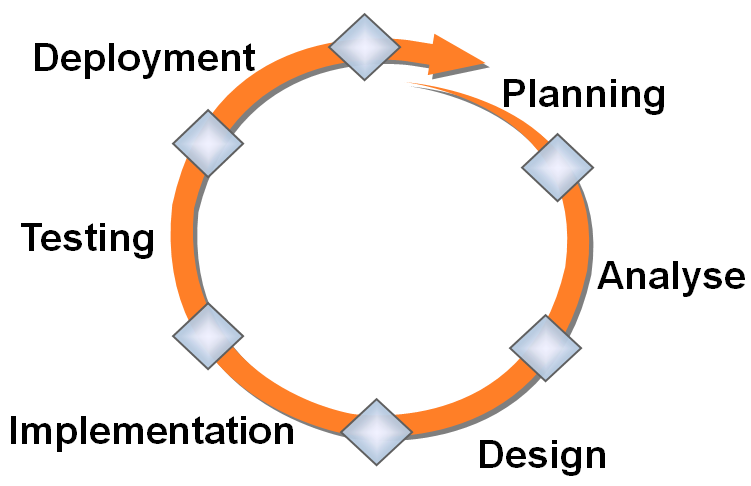
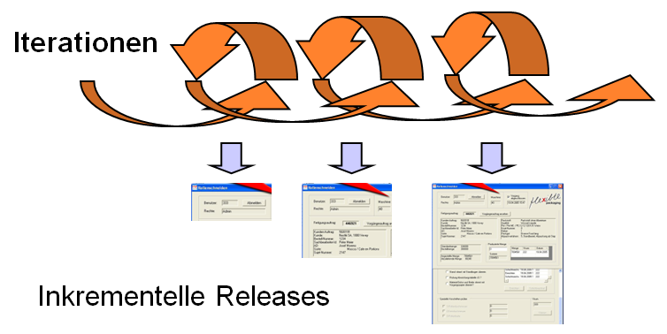
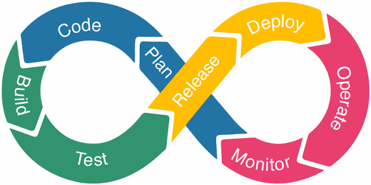

# T2

## Was ist SDLC (Software Development Life Cycle), und wie gliedert sich dieser Prozess?

### Welche Schritte umfasst der SDLC, und wie tragen diese zur Entwicklung und Bereitstellung von Software bei?

#### 1. Planung
#### 2. Analyse 
#### 3. Entwerfen 
#### 4. Codierung 
#### 5. Testen 
#### 6. Bereitstellung  
#### 7. Wartung  

Klar Definierte Phasen klarheit und eine Übersicht für das Team und auch der Stakeholder.

#### Die iterative Modelle hat die Vorteile: 

- Mit klaren Dokumentationen, welche den Fortschritt zwischen den Phasen anwendet wird die Zeit verkürzt von der Softwareproduktion und sommit auch die Entwicklungsproduktivität.

- Transparenz: Standartisiere Dokumentation und Offene Kommunikationwege führen dazu, dass über definierte prozesse Stakeholder darüber informiert werden was bisher erreicht worden ist.

### Wie wird der SDLC typischerweise in einem Projekt angewendet und gesteuert?

Der Software Development Life Cycle benuttz dei Entwicklungsprozess in klar definierte Phasen unterteilt. Die Steuerung wird über die Projektmanagement Methoden wie Scrum oder Wasserfall erfolgt.

Quellen:https://www.ibm.com/de-de/think/topics/sdlc
https://aws.amazon.com/de/what-is/sdlc/
https://www.atlassian.com/de/agile/project-management/project-management-methodologies
Abbildung (https://softwarecity.ch/blog/inkrementelles-und-iteratives-vorgehen)
Keine KI wurde benutzt für diesen Teil

## Was ist der DevOps Lifecycle, und wie ist er strukturiert?

### Wie ist der DevOps Lifecycle definiert, und welche Kernphasen beinhaltet er?

**Plan**
- Was soll überhaupt erreicht werden?
- Erstellung des Auftrags und Festlegung der Anforderungen.
- Sprint Meetings zur Planung und Verteilung der Aufgaben.
- Festlegung, was wann umgesetzt werden soll und welche Priorität die Aufgaben haben.

**Code**
- Entwicklung und Schreiben des eigentlichen Codes.
- Umsetzung der geplanten Funktionen und Features.

**Build**
- Sobald der Code existiert, wird überprüft, ob er überhaupt funktioniert und ausführbar ist.
- Der Quellcode wird kompiliert und notwendige Abhängigkeiten werden eingebunden.
- Erstellung eines ausführbaren Programms oder eines Pakets.
- Stichwörter: Compiling, Build, Executable.

**Test**
- Sicherstellen der Funktionalität und Fehlerfreiheit der Software.
- Überprüfung, ob die entwickelten Funktionen wie geplant funktionieren.
- Überprüfung, ob neue Änderungen bestehende Funktionen beeinträchtigen.

**Release**
- Gesamtüberprüfung des Übergangs vom getesteten Build zum Live-Deployment.
- Überprüfung, ob die Software bereit für die Veröffentlichung ist.
- Vorbereitung des Releases und Durchführung letzter Qualitäts- und Sicherheitskontrollen.
- Festlegung, wie und wann das Release veröffentlicht werden soll.

**Deploy**
- Die fertige Software wird auf die Produktivumgebung übertragen.
- Die neue Version wird für die Benutzer zugänglich gemacht.
- Ziel ist ein möglichst reibungsloser Übergang ohne Unterbrechung des laufenden Betriebs.

**Operate**
- Die Software befindet sich nun im Live-Betrieb und wird von den Benutzern verwendet.
- Sicherstellen, dass die Anwendung stabil und zuverlässig läuft.
- Verwaltung und Wartung der Server und Infrastruktur.
- Behebung von Problemen, die während des Betriebs auftreten.
- Bei Bedarf werden Updates und Anpassungen durchgeführt.

**Monitor**
- Kontinuierliche Überwachung der Software und der Infrastruktur.
- Sammeln von Daten über die Leistung und den Zustand der Anwendung.
- Erkennen von Fehlern, Ausfällen oder ungewöhnlichem Verhalten.
- Auswertung von Benutzerfeedback.
- Die gewonnenen Informationen werden wieder in die Planungsphase übernommen, um zukünftige Verbesserungen und neue Features umzusetzen

### Welche Ziele verfolgt der DevOps Lifecycle im Vergleich zu traditionellen Entwicklungsansätzen?

**Iterativ:** Der Entwicklungsprozess wiederholt sich kontinuierlich, anstatt nur einmal linear durchlaufen zu werden.

**Schnellere Reaktion:** Durch kürzere Entwicklungszyklen können Änderungen und Fehler schneller bearbeitet werden.

**Zusammenarbeit:** Development und Operations arbeiten eng zusammen und fungieren als ein gemeinsames Team mit geteilter Verantwortung.

https://www.ibm.com/think/topics/devops-lifecycle
https://www.geeksforgeeks.org/devops/devops-lifecycle/
https://www.consol.de/it-services/devops/lebenszyklus
Abbildung (https://medium.com/t%C3%BCrk-telekom-bulut-teknolojileri/devops-lifecycle-continuous-integration-and-development-e7851a9c059d)

## Welche Unterschiede gibt es zwischen dem SDLC und dem DevOps Lifecycle?

* Die Struktur vom SDLC wird oft in einem Kreis dargestellt, während der DevOps Lifecycle oft in einer liegenden Acht dargestellt wird. Dies kommt daher, dass DevOps aus den beiden Teams Development und Operations besteht, welche ihre eigene Aufgaben und Prozesse haben, aber trotzdem zusammenarbeiten. Bei SDLC arbeiten die Teams oft getrennt und kommunizieren wenig über aktuelle Issues. Das Ziel von DevOps ist ausserdem die Integration von Automation.

* Die Implementation von Automation in DevOps führt dazu, dass Delivery von Releases schneller und effizienter gehen. Im DevOps Lifecycle ist Agiles arbeiten ein wichtiger Bestandteil mit schnellen Iterationen.

## Was ist ein MVP (Minimum Viable Product), und welche Bedeutung hat es im DevOps Lifecycle?

* Ein MVP ist eine einfache und die simpelste Version eines Produktes, die Entwicklern erlaubt, zu testen ob das Produkt wirklich ein Problem von Kunden löst, und Feedback von Kunden und Users einzuholen.

* Welche Rolle spielt das MVP in den verschiedenen Phasen des DevOps Lifecycles, insbesondere im Hinblick auf schnelles Feedback und iterative Verbesserung?

Quelle: https://medium.com/@nalawade1000work/sdlc-vs-devops-25ff2dd0accf